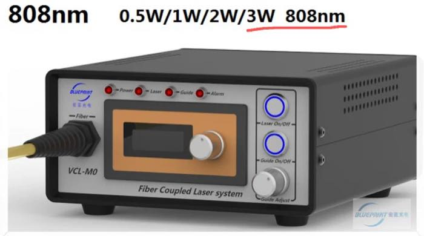
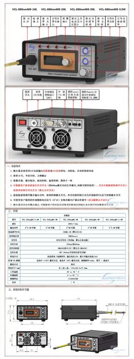

  

    
激光器 808 nm

    

      
设备名称：激光器 - 808 nm 存放地点：8#2014

      
设备图片：

      
      
<a href="/equipment/">返回设备说明</a>

    

  

  

    
设备说明

    

      
关键性能参数：808 nm，1–3 W，SMA 输出，准直径（原文如此）。

      
防护眼镜：确认下，放在激光器上面（原文备注，待确认）。

      
      
购买链接：<a href="https://item.taobao.com/item.htm?id=625491593807" target="_blank" rel="noopener noreferrer">[link]</a>

      
驱动与控制软件、参数手册：原文档未填写。

    

  

