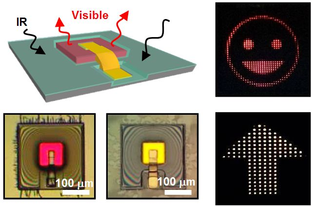
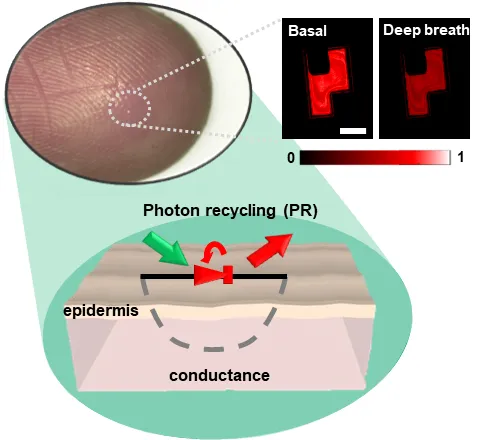
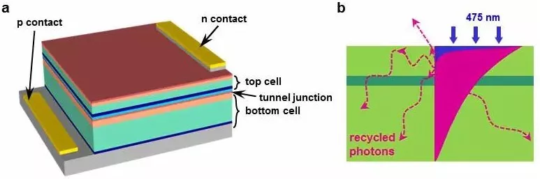

  

    <h2><strong>研究方向</strong></h2>
    
<strong>
      1. 面向脑科学（神经接口）应用的新型光电半导体器件 
      2. 面向生物医疗应用的植入式与可穿戴式传感微系统
    </strong>

    

      
    

  

  

    <h2><strong>新闻报道</strong></h2>
    <h3 class="news-section">新闻简介</h3>
    

      <article class="news-preview">
        

        <ul class="news-body">
          <li><a href="https://www.news.cn/sci-tech/20251209/64e0ab410736436f991e0482be4dfcfb/c.html" title="科技青年丨探微见宏图 · 花絮短视频 @新华网" target="_blank" rel="noopener noreferrer">科技青年丨探微见宏图 · 花絮短视频 @新华网</a></li>
          <li><a href="https://www.stdaily.com/web/gdxw/2025-12/05/content_443029.html" title="科技青年丨探微见宏图 @科技日报" target="_blank" rel="noopener noreferrer">科技青年丨探微见宏图 @科技日报</a></li>
        </ul>
      </article>
    

    <h3 class="news-section">1. 微纳光电器件类工作</h3>
    

      <article class="news-preview">
        

        <ul class="news-body">
          <li><a href="{{ site.research_1_1 | escape }}" title="植入式上转换光源 @知社学术圈" target="_blank" rel="noopener noreferrer">植入式上转换光源 @知社学术圈</a></li>
        </ul>
      </article>
      <article class="news-preview">
        

        <ul class="news-body">
          <li><a href="{{ site.research_1_2_1 }}" title="光学温度传感 @中国光学" target="_blank" rel="noopener noreferrer">光学温度传感 @中国光学</a></li>
          <li><a href="{{ site.research_1_2_2 }}" title="上转换温度传感研究新进展 @北京理工大学光电学院" target="_blank" rel="noopener noreferrer">上转换温度传感研究新进展 @北京理工大学光电学院</a></li>
        </ul>
      </article>
      <article class="news-preview">
        

        <ul class="news-body">
          <li><a href="{{ site.research_1_3_1 }}" title="新型光学传感机制 · 报道一" target="_blank" rel="noopener noreferrer">新型光学传感机制 · 报道一</a></li>
        </ul>
      </article>
      <article class="news-preview">
        

        <ul class="news-body">
          <li><a href="{{ site.research_1_3_2 }}" title="新型光学传感机制 · 报道二" target="_blank" rel="noopener noreferrer">新型光学传感机制 · 报道二</a></li>
        </ul>
      </article>
    

    <h3 class="news-section">2. 系统应用方面工作</h3>
    

      <article class="news-preview">
        

        <ul class="news-body">
          <li><a href="{{ site.research_2_1_1 }}" title="无线植入式脑组织氧含量监测 @腾讯新闻" target="_blank" rel="noopener noreferrer">无线植入式脑组织氧含量监测 @腾讯新闻</a></li>
          <li><a href="{{ site.research_2_1_2 }}" title="无线植入式脑组织氧含量监测研究进展 @北京理工大学光电学院" target="_blank" rel="noopener noreferrer">无线植入式脑组织氧含量监测研究进展 @北京理工大学光电学院</a></li>
        </ul>
      </article>
      <article class="news-preview">
        

        <ul class="news-body">
          <li><a href="{{ site.research_2_2 }}" title="可穿戴式柔性光疗贴片研究进展 @北京理工大学光电学院" target="_blank" rel="noopener noreferrer">可穿戴式柔性光疗贴片研究进展 @北京理工大学光电学院</a></li>
        </ul>
      </article>
    

  

<!-- Publish article previews after Pages queue recovery -->
